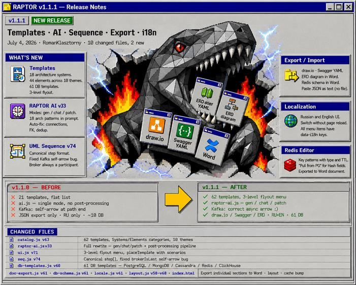
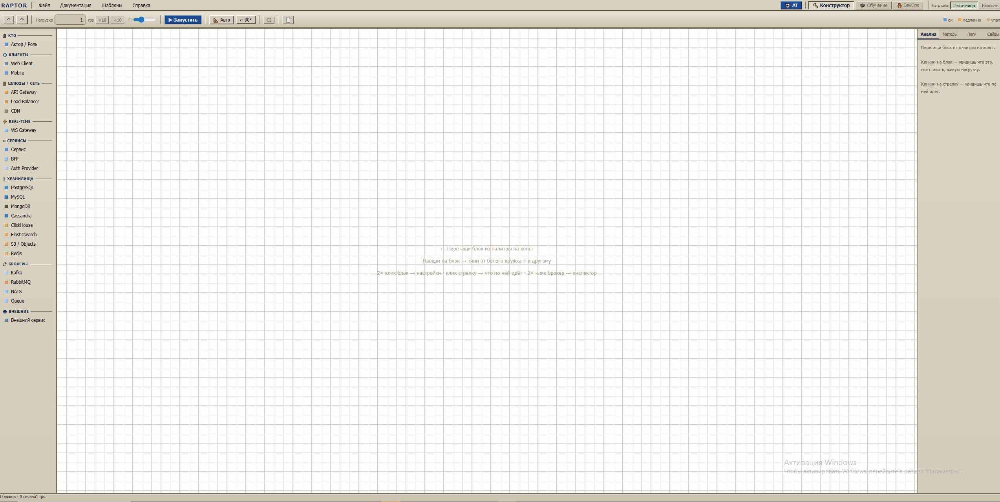

**🌐 语言:** [🇬🇧 English](README.md) · [🇷🇺 Русский](README_RU.md) · [🇺🇦 Українська](README_UA.md) · [🇩🇪 Deutsch](README_DE.md) · [🇫🇷 Français](README_FR.md) · [🇪🇸 Español](README_ES.md) · [🇵🇱 Polski](README_PL.md) · [🇯🇵 日本語](README_JA.md)

# RAPTOR — 架构构造器

> 基于浏览器的微服务系统设计、流量仿真和文档生成工具。无需构建步骤，无需 npm — 打开 `index.html` 即可开始使用。

[](https://romanklasztorny.github.io/raptor/)
[](https://github.com/RomanKlasztorny/raptor/releases/latest)



---

## 快速开始

```bash
npx serve .     # → http://localhost:5500
```

---

## ⚡ 配置 — RAPTOR AI

> 免费 · 无需信用卡 · 30秒完成

```
① console.groq.com → 注册 → API Keys → Create API Key
② 复制密钥  →  gsk_••••••••••••••••••••••••
③ RAPTOR  →  🤖 AI  →  粘贴密钥  →  Enter  ✓
```

密钥保存在 `localStorage` 中 — 每个浏览器只需输入一次。

---

## 🔌 与任意 LLM 配合使用（ChatGPT、Claude、Gemini…）

不用 Groq？用**任意模型**生成 JSON 然后导入：

```
① 打开  RAPTOR_FORMAT.md  ← 完整 JSON 结构 + 示例
②   ↓
   粘贴到 ChatGPT / Claude / Gemini：
   「为 [你的系统] 生成 RAPTOR JSON，使用以下结构：…」
③   ↓
   复制回复中的 JSON
④ RAPTOR  →  文件 → 导入 JSON  →  粘贴文本  →  确定
   ↓
   ✦ 画布立即填充：模块、连接、数据库结构、场景
```

> **提示：** 将 `RAPTOR_FORMAT.md` 作为文件附件上传 — 大多数模型可完整读取。

---

## 功能特性

### 架构图
- 组件块：Actor、Client、API Gateway、Load Balancer、CDN、WebSocket GW、BFF、Service、Auth、PostgreSQL、MySQL、MongoDB、Redis、Cassandra、ClickHouse、Elasticsearch、S3、Kafka、RabbitMQ、NATS、Queue、External
- 拖放操作，碰撞检测，双向箭头
- 按层自动布局 — **Auto** 按钮
- 工具栏中的 **C1 / C2 / C3 / Seq** 层级切换

### 模板
- **18 个系统**：银行、即时通讯、电商平台、YouTube、搜索引擎、打车、社交动态、外卖、共享汽车、Spotify、Netflix、交友、加密货币交易所、在线教育、健身、酒店预订、云存储、待办事项
- **44 个组件**，分 10 个主题
- **61 个数据库模板**：PostgreSQL、MongoDB、Cassandra、Redis、ClickHouse
- 三级飞出菜单

### 仿真
- 小球沿场景路径运动
- 点击小球 → 查看带延迟的 hop-trace 详情
- **混沌模式**：节点故障、性能降级、缓存重置

### UML 时序图
- 从场景自动生成，符合 PlantUML 标准
- Kafka → `-)` · 同步返回 · `group alt/else`
- **📋 PlantUML** 按钮 — 复制到 Confluence
- ~~代码生成图表~~ → **点击生成图表**：点击画布上的模块 — RAPTOR 自动沿连接找到路径，高亮显示可选的下一个节点。每次点击后弹出窗口填写步骤（方法、URI、响应）。按 Enter — 时序图即时生成
- 功能持续开发中；简单 CRUD 流程已支持两次点击完成 — 直接在画布上编辑高层和低层流程

### RAPTOR AI
- `🤖 AI` 按钮 → 右侧聊天面板
- 由 **Groq** 驱动（llama-3.3-70b，免费套餐）— 从 [console.groq.com](https://console.groq.com) 粘贴 API 密钥
- 模式：**gen**（完整生成）、**chat**（规划）、**patch**（增量更新）

### 导出
- **Word (.docx)**、**draw.io**、**Swagger/OpenAPI YAML**

---

## 状态管理

所有数据存储在全局对象 `S` 中。保存 → JSON 文件。加载 → 文件 → 导入 JSON → 粘贴文本 → 确定。
